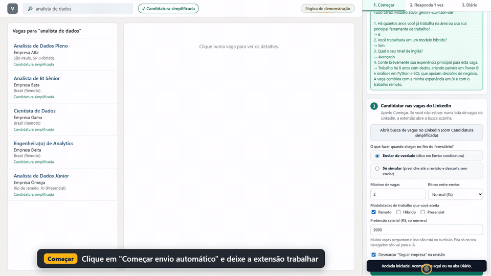
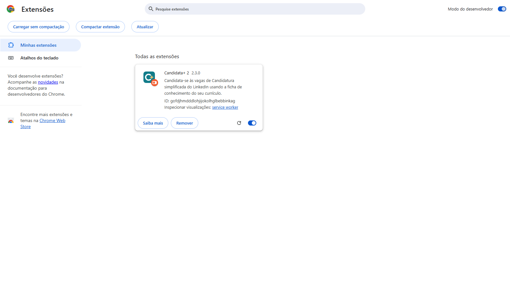
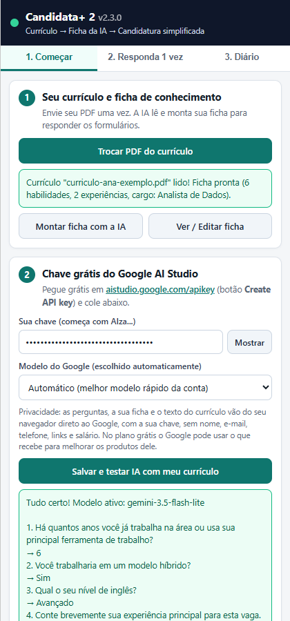
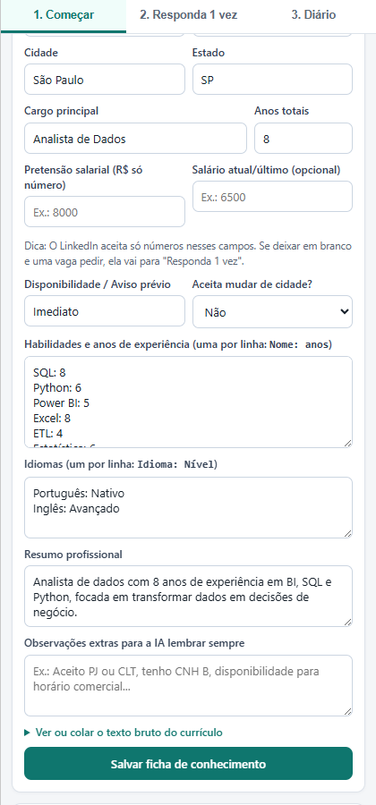
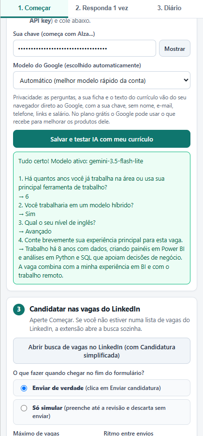
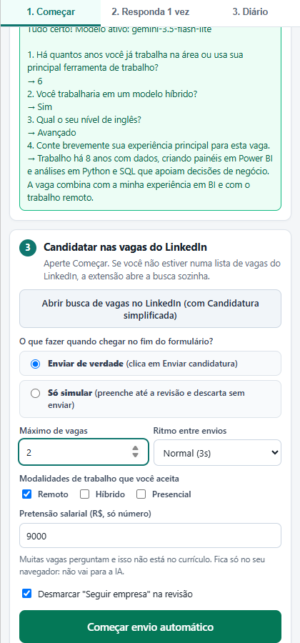
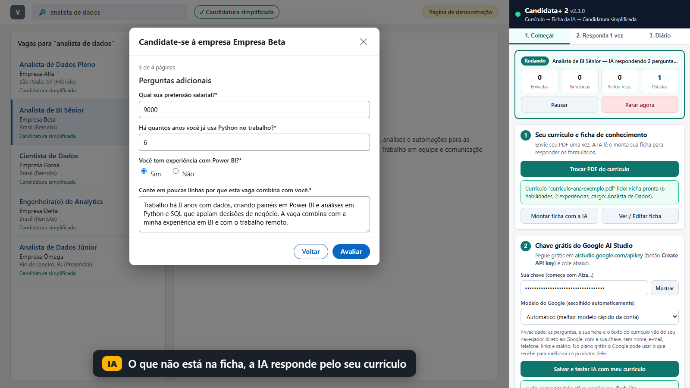
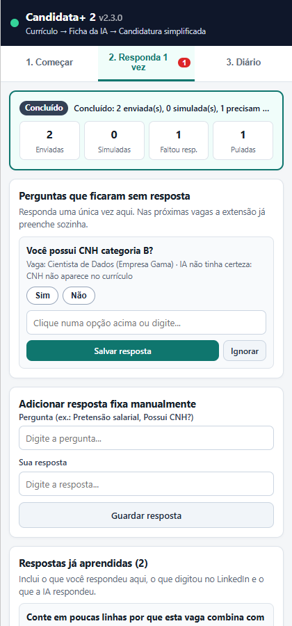
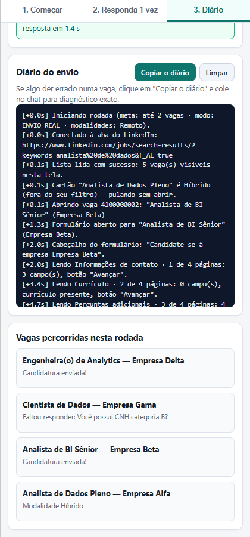

# Candidata+ 2

**Extensão grátis do Chrome que se candidata sozinha às vagas de "Candidatura simplificada" do LinkedIn.** A IA grátis do Google responde às perguntas do formulário com base no seu currículo. O que ela não souber vira uma pergunta para você responder uma vez só, e fica guardado para as próximas vagas.

Feita para ajudar quem está em busca de recolocação (#OpenToWork) a gastar menos tempo preenchendo o mesmo formulário dezenas de vezes.



▶️ **Vídeo de como usar (1min50s):** [candidata-plus-como-usar.mp4](https://github.com/festinalli/candidata-plus/releases/latest/download/candidata-plus-como-usar.mp4)
*(demonstração gravada com uma página de vagas simulada e uma pessoa fictícia)*

---

## Antes de usar, leia

- **Os Termos de Uso do LinkedIn não permitem ferramentas automáticas.** Usar esta extensão pode levar o LinkedIn a limitar ou suspender a sua conta. A decisão e o risco são seus.
- **Use com responsabilidade:** candidate-se só a vagas que combinam com você, com um número moderado por dia, e confira no Diário o que foi enviado.
- **Na primeira vez, use "Só simular":** a extensão preenche tudo até a revisão e descarta sem enviar. Assim você vê como ela responde antes de enviar de verdade.
- A extensão **não é do LinkedIn nem do Google** e não tem ligação com eles.

---

## Instalar (5 minutos)

1. **Baixe o ZIP** da versão mais nova em [**Releases**](https://github.com/festinalli/candidata-plus/releases/latest) (arquivo `candidata-plus-v2.x.x.zip`).
2. **Extraia** o ZIP numa pasta que você não vá apagar (por exemplo, `Documentos\candidata-plus`).
3. No Chrome, abra o endereço **`chrome://extensions`**.
4. Ligue o **Modo do desenvolvedor** (canto superior direito).
5. Clique em **Carregar sem compactação** e escolha a pasta que você extraiu (a que tem o arquivo `manifest.json` dentro).
6. Clique no ícone de **quebra-cabeça** na barra do Chrome e no **alfinete** ao lado da Candidata+ 2, para o ícone ficar sempre à vista.



> O Chrome pode mostrar um aviso sobre extensões no modo do desenvolvedor. É normal para extensões instaladas fora da Chrome Web Store.

Para **atualizar**: baixe o ZIP novo, extraia por cima da **mesma pasta** e clique no botão de recarregar (↻) da Candidata+ 2 em `chrome://extensions`. Os seus dados continuam guardados.

---

## Usar em 3 passos

Entre no LinkedIn e clique no ícone da Candidata+ 2: o painel abre do lado direito.

### Passo 1: envie o seu currículo

Clique em **Escolher PDF do currículo**. A extensão lê o texto do PDF no seu computador. Depois do Passo 2, a IA usa esse texto para montar a sua **Ficha de conhecimento**: cargo, anos de experiência, habilidades com anos de uso, idiomas, formação.

Em **Ver / Editar ficha** você confere e corrige o que quiser. Vale preencher também:

- **Pretensão salarial** e **salário atual** (só números). Muitas vagas perguntam, e isso não está no currículo.
- **Observações extras para a IA**: "aceito PJ ou CLT", "tenho CNH B", "disponível para viagens"...

| Currículo lido | Ficha de conhecimento |
| --- | --- |
|  |  |

### Passo 2: cole a sua chave grátis do Google AI Studio

1. Abra **[aistudio.google.com/apikey](https://aistudio.google.com/apikey)** e entre com a sua conta Google.
2. Clique em **Create API key** (Criar chave de API) e copie a chave (começa com `AIza...`).
3. Cole no painel e clique em **Salvar e testar IA com meu currículo**.

A extensão faz 4 perguntas de teste e mostra as respostas. Se aparecer "Tudo certo!", está funcionando. A chave é grátis; o Google limita quantas perguntas por minuto e por dia cada chave pode fazer.



### Passo 3: escolha como enviar e comece

- **Modalidades que você aceita** (Remoto, Híbrido, Presencial). As outras são puladas sem abrir.
- **Pretensão salarial** (também pode ser preenchida aqui).
- **Máximo de vagas** por rodada e **ritmo** entre envios.
- **Enviar de verdade** ou **Só simular**.
- Clique em **Começar envio automático**.

Se você não estiver numa lista de vagas, a extensão abre sozinha a busca com o filtro "Candidatura simplificada" e o cargo da sua ficha. Você também pode abrir antes a sua própria busca do LinkedIn, com os filtros que quiser, e clicar em Começar.

Deixe a aba do LinkedIn aberta e na frente enquanto o envio roda. Você pode **Pausar** ou **Parar** a qualquer momento.

| Configuração | Envio rodando |
| --- | --- |
|  |  |

### Depois: "Responda 1 vez" e "Diário"

- **2. Responda 1 vez:** as perguntas que nem a sua ficha nem a IA souberam responder. Responda uma vez e a resposta é usada nas próximas vagas. A vaga que parou nessa pergunta foi descartada sem enviar; ela volta a aparecer na próxima rodada.
- **3. Diário:** tudo o que aconteceu, vaga a vaga e página a página: de onde veio cada resposta (ficha, resposta guardada, IA), quanto a IA demorou e o motivo de cada vaga pulada. O botão **Copiar o diário** ajuda a pedir suporte.

| Responda 1 vez | Diário |
| --- | --- |
|  |  |

---

## Como ela responde cada pergunta

1. **Campo já preenchido pelo LinkedIn** (e-mail, telefone, currículo): mantém.
2. **Respostas guardadas**: o que você respondeu em "Responda 1 vez" ou digitou no LinkedIn para a mesma pergunta.
3. **Ficha**, sem chamar a IA: salário, anos de uma habilidade, nível de idioma, modalidade, autorização de trabalho, mudança de cidade, aviso prévio.
4. **IA (Google Gemini)**: o resto, com a ficha e o texto do currículo. A IA é instruída a dizer que não sabe quando a resposta não está no currículo, em vez de inventar.
5. **Ninguém soube:** a pergunta vai para "Responda 1 vez" e a vaga é descartada sem enviar.

Perguntas opcionais sem resposta ficam em branco. A caixa "Seguir empresa" é desmarcada na revisão (dá para mudar no Passo 3).

---

## Privacidade

- **Tudo fica no seu navegador**: currículo, ficha, respostas e diário ficam guardados no próprio Chrome. Não existe servidor da Candidata+ e nada é enviado para quem fez a extensão.
- **A IA é chamada com a SUA chave**, direto do seu navegador para o Google. Vão as perguntas do formulário, a sua ficha e o texto do currículo, **sem nome, e-mail, telefone, links, CPF e salário** (a extensão tira esses dados antes de enviar).
- **No plano grátis**, as regras do Google AI Studio dizem que o Google pode usar o que recebe para melhorar os produtos dele, e que revisores humanos podem ler esse conteúdo (desligado da sua conta). Se isso incomodar, use uma chave de um projeto com faturamento ativo (plano pago), ou revise o que está no currículo e na ficha.
- Para apagar tudo, remova a extensão em `chrome://extensions`.

---

## Problemas comuns

| O que aconteceu | O que fazer |
| --- | --- |
| "Não foi possível comunicar com a aba do LinkedIn" | Dê F5 na aba do LinkedIn e clique em Começar de novo. Isso acontece depois de instalar ou atualizar a extensão. |
| A vaga foi pulada como "site externo" | A vaga não tem Candidatura simplificada (o botão é "Candidatar-se", com uma setinha). A extensão só faz Candidatura simplificada. |
| "Limite gratuito atingido" | A chave grátis tem limite por minuto e por dia. Espere um pouco ou continue no dia seguinte. |
| A IA respondeu algo errado | Corrija na ficha ou em "Responda 1 vez", ou apague a resposta em "Respostas já aprendidas". |
| O envio parou com "Interrompido" | O Chrome desligou a extensão no meio do envio (ou ela foi recarregada). Clique em Começar de novo; as vagas já enviadas são puladas. |

Encontrou um erro? Abra uma [issue](https://github.com/festinalli/candidata-plus/issues) e cole o texto do botão **Copiar o diário**. Antes de colar, confira se não tem dado pessoal no texto.

---

## Para quem programa

Extensão Chrome (Manifest V3) em TypeScript, sem servidor. Precisa do Node.js 24 (ou 22.18 em diante).

```bash
npm install
npm run typecheck   # confere os tipos
npm test            # testes de unidade e de página simulada (jsdom)
npm run build       # monta a extensão em dist/ (carregue essa pasta no Chrome)
npm run e2e         # roda a extensão num Chromium de verdade contra uma página de vagas simulada
npm run zip         # gera release/candidata-plus-v<versão>.zip
npm run record      # grava o vídeo de demonstração (precisa do ffmpeg)
```

Na primeira vez, para `e2e` e `record`: `npx playwright install chromium`.

| Pasta | O que tem |
| --- | --- |
| `src/background` | O orquestrador do envio (`runner.ts`) e as mensagens do painel (`service-worker.ts`). |
| `src/content` | O que roda na página do LinkedIn: ler a lista, abrir a vaga, ler e preencher o formulário. |
| `src/core` | A IA (`gemini.ts`), a ficha (`knowledge.ts`), quem responde cada campo (`solver.ts`) e a limpeza de dados de contato (`redact.ts`). |
| `src/panel` | O painel lateral. |
| `tests`, `scripts` | Testes, páginas simuladas e os roteiros de teste no navegador e de gravação. |

O LinkedIn muda a página com frequência. Quando algo quebrar, o Diário mostra em que passo parou, e os testes em `tests/real-run-fixes.test.ts` mostram como cada caso real foi reproduzido.

---

## In English (short)

Candidata+ 2 is a free, open-source Chrome extension that applies to LinkedIn "Easy Apply" jobs for you, using Google's free Gemini API (your own key) to answer form questions from your résumé. Everything stays in your browser; contact details and salary are stripped before anything is sent to the AI. Automating LinkedIn is against its User Agreement: use at your own risk. The interface is in Brazilian Portuguese.

---

## Licença

[MIT](LICENSE): pode usar, copiar, modificar e distribuir, sem garantia nenhuma.
